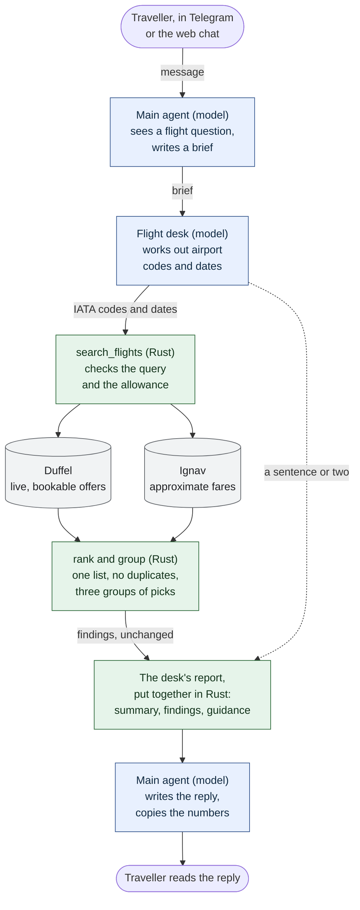
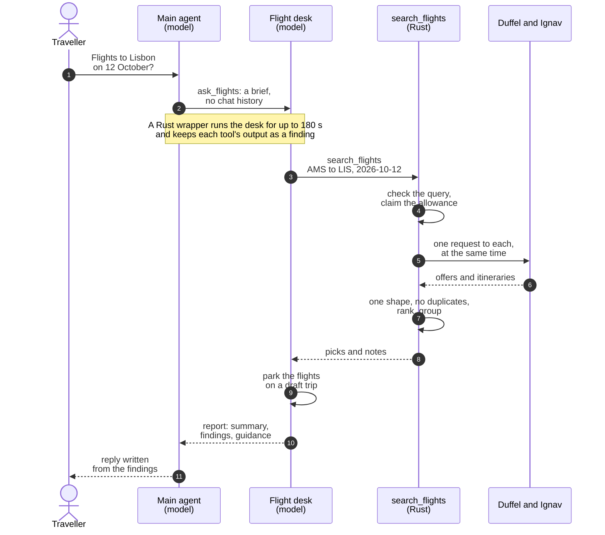
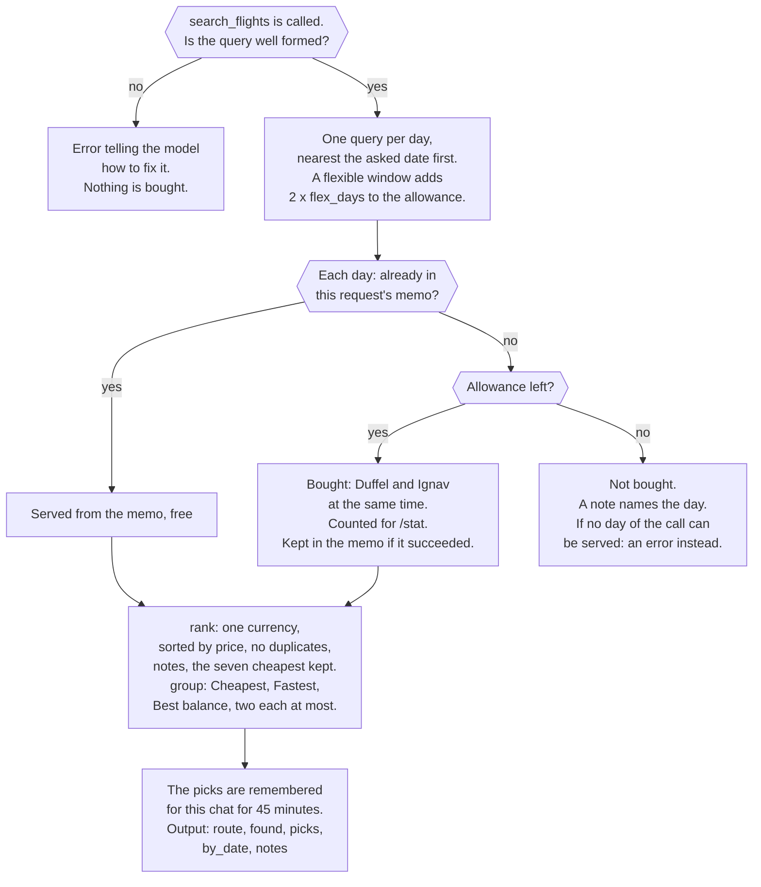
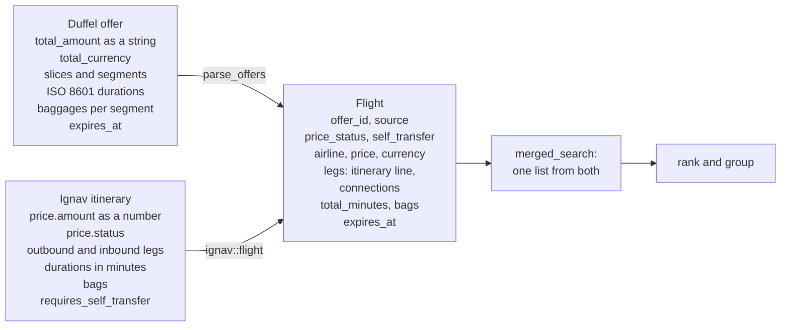
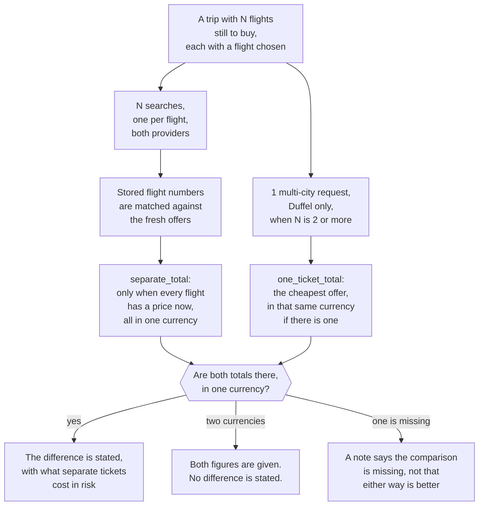
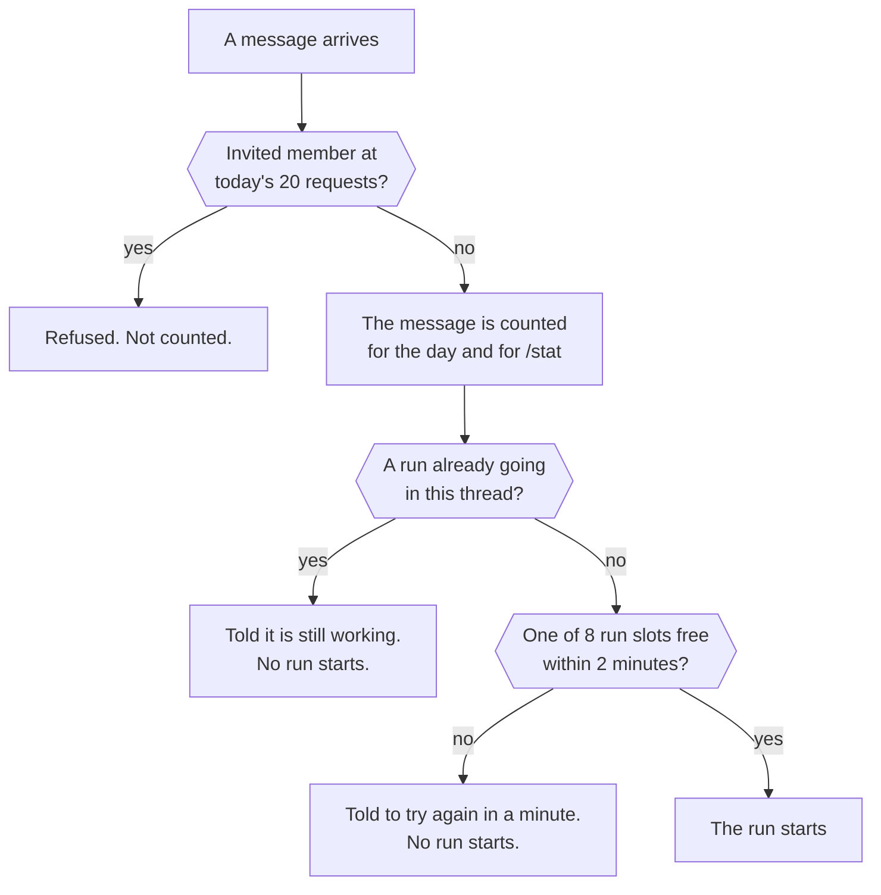

# How Scout searches flights and compares prices

Written 2026-11-26 from the code at commit `7ec4765`. Paths are relative to
the repository root. A number called *measured* was observed in production
or on a live API. Outside section 7.9 it is quoted from a code comment or
the README; section 7.9 was measured for this document, with a script that
is in the repository. Every other number is a constant in the code, apart
from two kinds worked out for this document: the prompt sizes in section
7.6, counted from the prompt constants as the model receives them, and the
sums in section 7.8. The providers' prices were read off their own pricing
pages on 2026-11-26. Everything else about how the providers behave is taken
from the code comments and the README.

Scout answers a flight question with two language-model agents, and a body of
Rust between them and the two fare providers. The design follows one rule,
the README's: **the model decides what to look for, Rust decides what's
true.** This document follows one flight question from the message to the
reply. Then it explains how two providers' answers become one list, how that
list is ranked, which work is done in Rust and why, and how the cost of a
search is kept under control. [Section 5.4](#54-what-is-still-left-to-the-prompt)
lists the rules that only a prompt keeps, and not code.

## Contents

1. [The short version](#1-the-short-version)
2. [A flight question, end to end](#2-a-flight-question-end-to-end)
3. [Two providers, one answer](#3-two-providers-one-answer)
4. [How prices are compared](#4-how-prices-are-compared)
5. [What Rust does and what the model does](#5-what-rust-does-and-what-the-model-does)
6. [What the traveller sees](#6-what-the-traveller-sees)
7. [Economy: what a search costs and how it is capped](#7-economy-what-a-search-costs-and-how-it-is-capped)
8. [Limits and rough edges](#8-limits-and-rough-edges)
9. [Where to look in the code](#9-where-to-look-in-the-code)

## 1. The short version

- A flight question goes to the **flight desk**: a second agent that the main
  agent calls as one tool, `ask_flights`. The desk sees a written brief and
  nothing else of the conversation.
- The desk calls `search_flights`. Rust checks the query, asks **Duffel and
  Ignav at the same time**, turns both answers into one `Flight` shape,
  removes duplicates and ranks what is left.
- Duffel sells live offers that can be paid for. Ignav sells fare data that
  its own documentation calls approximate. Every row keeps a label saying
  which of the two it is.
- Sorting, durations, layovers, the one-line itinerary and the choice of
  Cheapest, Fastest and Best balance are computed in Rust. The model is told
  to copy the numbers into the reply, not to compute them.
- A search has three meters: model tokens, Duffel searches and Ignav
  requests. A run is bounded in turns and in time, apart from a few
  follow-up calls ([section 7.3](#73-limits-inside-a-run)). Each request has
  an allowance of flight searches that starts at four and grows only with
  what was asked for.



Blue boxes are a language model. Green boxes are Rust. Grey is a provider
outside Scout. The picture leaves one arrow out: the search result also goes
back to the desk, which reads it to park flights on a draft trip and to write
its sentence. The sequence in section 2.1 shows that.

## 2. A flight question, end to end

### 2.1 The path of one question



### 2.2 Step by step

1. **Before the run.** The channel, Telegram or the web chat, checks the
   daily cap for invited members and counts the message. `run_agent` in
   [`run.rs`](../crates/scout-core/src/run.rs) then allows one run at a time
   in a thread and takes one of eight run slots.
   [Section 7.2](#72-before-a-run-starts) has the details.
2. **The main agent reads it.** `build_agent` in
   [`agent.rs`](../crates/scout-core/src/agent.rs) gives it the tool
   `ask_flights` whenever a Duffel or an Ignav key is set. Its prompt says to
   send every flight and trip question there, "never a web search, and never
   compare_prices". It must write a self-contained **brief**: route, dates
   with the year written out, passengers, cabin, whether the dates are
   flexible, and any offer id the traveller is pointing at, with the provider
   it came from. A route and a date are enough to ask: passengers default to
   one adult.
3. **The specialist wrapper starts the desk.** `Specialist::call` in
   [`specialist.rs`](../crates/scout-core/src/specialist.rs) runs a nested
   agent with the brief as its only prompt and no history. It has 180 seconds.
   Each nested tool call is reported to the chat as progress, and each nested
   tool's real output is kept as a **finding**.
4. **The flight agent works.** Its prompt is `FLIGHT_PREAMBLE` in
   [`flights.rs`](../crates/scout-core/src/flights.rs), without the rules for
   booking tools this install does not have, and with today's date added. It
   has up to 12 model turns in a pass. It runs on `FLIGHT_MODEL`, which is
   the main model unless set otherwise. It works out the IATA codes, fills in
   the year of a date that has none, and calls `search_flights`. Its prompt
   tells it not to search when the brief lacks something a search needs, and
   to report what is missing.
5. **`search_flights` runs.** [Section 2.3](#23-inside-search_flights) walks
   through it.
6. **The desk writes the plan down.** Its prompt tells it to do this every
   time it searches: `add_trip_segment` for each leg, `add_trip_option` for a
   flight found. That builds a draft trip in the database and calls no
   provider. A segment is one direction on one date, so `add_trip_option`
   refuses a return offer.
7. **The report goes back.** The main agent receives `Report { summary,
   findings, guidance }`:
   - `summary` is the desk's own one or two sentences. Its prompt forbids
     prices, times and links there.
   - `findings` holds every nested tool's JSON exactly as the tool returned
     it. The main prompt says to take every number, time and link from here,
     "never from the summary and never from memory". Both halves are prompt
     rules: nothing in Rust removes a number from the summary.
   - `guidance` is the set of presentation rules that apply to what the desk
     actually did, chosen in Rust by `flights::guidance`.
8. **The main agent writes the reply** from the findings, following the
   guidance. `run.rs` then checks the reply:
   - A reply that is only reasoning is sent back once to be acted on.
   - A tool call written out as text is sent back once to be repaired.
   - The first 12 distinct links in the reply are probed, except a Duffel
     checkout link, which opening would spend. A link is dead when it answers
     404 or 410. Dead links are sent back once, together, to be corrected,
     and any still dead after that are struck out.

   The conversation is then saved, and the run is closed with its token
   count.

If the desk stops on its own limits, out of turns, out of time or stalled,
its findings are not thrown away. The report still carries what was
gathered, and its summary says the lookup was cut short and why. The desk
returns an error only when no tool call succeeded at all. The run's own
deadline is another matter: a desk cut off by it loses its report
([section 8](#8-limits-and-rough-edges)).

### 2.3 Inside `search_flights`

The tool is `FlightSearchTool` in
[`tools/duffel.rs`](../crates/scout-core/src/tools/duffel.rs). The file is
named after the first provider and holds the code both providers share.



**The query is checked first, because a refused query costs nothing.**
`FlightQuery::validate` rejects:

- an origin or destination that is not exactly three letters, or the two
  being the same place;
- a date not written `YYYY-MM-DD`, or a return date before the departure;
- fewer than 1 or more than 9 adults;
- a cabin other than `economy`, `premium_economy`, `business` or `first`;
- more than 2 connections asked for as a maximum;
- a flexible window wider than ±3 days.

A date that is well written and does not exist, such as 2026-02-30, is
refused one step later, still before anything is bought. Each refusal is
worded as an instruction to the model. A wrong origin answers `origin must
be a 3-letter IATA airport or city code (AMS, LHR, NYC), not "Amsterdam" —
use the code for the place the traveller named`.

Two things are not checked: whether three letters are a real airport, and
whether the date has already passed. [Section 8](#8-limits-and-rough-edges)
comes back to both.

**One query per day.** The code assumes neither provider prices a calendar,
so a window of ±3 days is seven separate searches. Ignav's pricing page now
lists a search over up to 31 departure dates as one request
([section 8](#8-limits-and-rough-edges)). `FlightQuery::window` lists the days
nearest the requested date first. If the allowance runs out part-way, the
far edge of the window is lost and the day the traveller named is not. On a
return trip the return date moves with the outbound, so a week away stays a
week away and the window stays seven searches where it could have been 49.

**The memo and the allowance.** `FlightBudget` in
[`tools/budget.rs`](../crates/scout-core/src/tools/budget.rs) is made once
per request. It holds what each successful search in this request returned,
keyed by route, dates, passengers, cabin and connection limit. The key is
normalised, so `ams` then `AMS`, or one adult asked for by default and then
by number, is one search. A day already in the memo is served free. Any
other day has to claim one unit of the allowance.
[Section 7.4](#74-the-flight-search-allowance) explains how the allowance is
set.

When no day of a call can be served, the call returns an error and no
output. With an allowance of four it reads: `this request has already used
its 4 flight searches — answer now with the routes you have already looked
up rather than searching another`.
When some days of a window can be served and others cannot, a note names the
days that were not checked.

**Both providers, at once.** Days run concurrently, and inside each day
`merged_search` asks Duffel and Ignav concurrently. One provider failing
does not lose the other's answer. A day fails only when nothing came back
and a provider failed. For a single date that failure is the tool's error.
In a flexible window a failed day does not sink the others, and a note lists
the days that returned no prices.

**Rank, group, remember.** All the flights from all the days go to `rank`,
described in [section 4](#4-how-prices-are-compared). The picks are then
stored in `ShownFlights`, which [section 2.5](#25-booking) uses.

**What comes back** is `FlightSearchOutput`:

| Field | What it holds |
|---|---|
| `route` | The search as asked, for the reply to quote: `AMS-LIS 2026-10-12, back 2026-10-19 ±2` |
| `found` | Comparable offers before the list was cut down |
| `currency` | The one currency every row is in |
| `cheapest`, `fastest` | The cheapest offer and the quickest offer of all that were found |
| `picks` | What to present: `cheapest`, `fastest` and `balanced`, at most two options each |
| `by_date` | Flexible windows only: the lowest fare per day |
| `notes` | Sentences the reply has to act on. Each note from the ranking starts with the route it is about |

An empty result is an ordinary answer with `found: 0`. "Nothing flies that
route on that day" is a finding, and the note tells the model to say so
plainly and not to claim an alternative it has not searched.

### 2.4 Flexible dates

The desk's prompt tells it to pass `flex_days`, up to 3, only when the brief
says the dates are flexible or asks whether another day is cheaper. The
prompt and the parameter's own description both say each day is a separate
paid search.
`by_date` then lists each day whose search succeeded: the lowest price found
that day, its currency, its airline and how many offers came back. The picks
are still chosen across the whole window. Measured on AMS–LIS: €101 to €143
across one week (README).

### 2.5 Booking

Booking happens in a later message than the search: "flights to Hong Kong",
then "book the Etihad one". By then the per-request memo is gone. So
[`tools/shown.rs`](../crates/scout-core/src/tools/shown.rs) keeps the picks
each conversation was shown, for 45 minutes and at most 200 per
conversation. Only picks are kept, so only a pick can be parked on a trip or
looked up for booking links.

| | `flight_booking_links` (Ignav rows) | `create_booking_link` (Duffel rows) |
|---|---|---|
| Registered when | An Ignav key is set | A Duffel key is set, Duffel Links is enabled, and the bot knows its own return address |
| Refuses before paying | An offer id this chat was never shown, or a row that is not Ignav's | — |
| Returns | The airline's own page and any resellers, airlines first, each with its price. The page opens with the flight already selected | A Duffel-hosted checkout link. It opens on its own search box and cannot be pre-filled |
| Price check | The lookup returns today's fare. Rust compares it with the price the chat was shown and adds a note when it has risen or fallen by a cent or more | — |
| Lifetime | — | Single use: 24 hours unopened, 20 minutes once opened |

Scout never takes a payment or a passenger detail. `DuffelClient` has no
method that creates an order.

### 2.6 Trips and finalising

A trip stores an **itinerary**, never an offer: the airline, the flight
numbers, the itinerary line, the times, the duration, the provider, and the
price and currency it had when it was parked. Offers expire within minutes
and a plan outlives the conversation that made it.

`finalise_trip` in
[`tools/trips.rs`](../crates/scout-core/src/tools/trips.rs) is the only thing
that produces current prices for a trip. It refuses before buying anything
when the trip has no flights, when a flight still to buy has no option or
has several and none chosen, or when the dates do not run forwards. Flights
already booked are skipped. Then, at the same time, it searches each flight
still to buy again and, when there are two or more, asks Duffel what those
flights cost as one ticket. The stored flight numbers are matched against
the fresh offers.
[Section 4.5](#45-a-trip-separate-tickets-against-one-ticket) covers the
comparison.

## 3. Two providers, one answer

### 3.1 What each one sells

| | Duffel | Ignav |
|---|---|---|
| What an answer is | A live offer, payable at the stated price until it expires | Fare data with links out to whoever sells it |
| Label in Scout | `bookable` | `approximate` when Ignav says `verified`, `unconfirmed` otherwise |
| How to show the price | As a price | As "from EUR 180", naming where it came from |
| Request | `POST /air/offer_requests?return_offers=true` on `api.duffel.com`. A return is a second slice in the same request | `POST /fares/one-way` or `POST /fares/round-trip` under `ignav.com/api`: two endpoints |
| Money | A decimal string, `"62.19"` | A number |
| Durations | ISO 8601, `PT2H30M`, `P1DT2H5M` | Minutes |
| Currency | As the offer states it | Follows the `market` country sent with the request. The default is US, so dollars |
| Separate tickets (self-transfer) | Never | Flagged with `requires_self_transfer` |
| Expiry | `expires_at` on each offer | None |
| Multi-city as one ticket | Yes | Not used. The code says there is none. Ignav's pricing page lists multi-city search, without saying whether it is one ticket |
| Where to buy | Hosted checkout, when Duffel enables it for the account | The airline's page and resellers, flight pre-selected |
| List price | $0.005 a search with no orders; free against 1,500 searches per order | 1,000 free requests, then $0.002 each |

### 3.2 One shape

Both answers are turned into the same struct, `Flight`, so everything after
the parsers is written once. `parse_offers` in `tools/duffel.rs` reads
Duffel. `flight` in
[`tools/ignav.rs`](../crates/scout-core/src/tools/ignav.rs) reads Ignav.



| `Flight` field | From Duffel | From Ignav |
|---|---|---|
| `offer_id` | The offer's `id` | `ignav_id` |
| `source` | `duffel` | `ignav` |
| `price_status` | Always `bookable` | `approximate` for `verified`, else `unconfirmed` |
| `self_transfer` | Always false | `requires_self_transfer` |
| `airline` | The owner's name, else its IATA code | The outbound leg's carrier |
| `price` | `total_amount` parsed as a number, plus the booking fee when one is configured | `price.amount` |
| `currency` | `total_currency` | `price.currency` |
| `legs` | One per slice | Outbound, then inbound |
| Leg duration | The slice's duration, else the sum of its segments when every one states one | The leg's minutes, else the sum of its segments when every one states one |
| Flight numbers | Marketing carrier code and number of each segment | The same, from Ignav's field names |
| `stops` | Changes of plane, plus any technical stop inside a segment | Changes of plane |
| `connections` | For each change: the airport, the wait, and whether the onward flight leaves from another airport | The same |
| Bags | The smallest allowance any segment grants, per passenger | `bags.checked` and `bags.carry_on` |
| `expires_at` | The offer's | None |

Three rules hold for both parsers:

- **A missing price is not a zero.** An offer with no usable price or no
  currency is dropped, never given a default. A defaulted zero would sort to
  the top and be reported as a free flight.
- **A missing duration is not zero minutes.** It is "not stated", or it
  would sort as the fastest flight on offer.
- **Bags not stated is not no bags.** The field is empty in that case. For
  Duffel the trip's allowance is the smallest any segment grants: a checked
  bag on the way out and none on the way home is not a checked bag included.

### 3.3 Currency

Scout holds no exchange rate, so it never converts. It does two things
instead.

- **It asks Ignav for the traveller's currency.** `fare_market` in
  `agent.rs` reads the first profile fact whose key starts with `delivery_`
  and sends its country to Ignav as `market`. It reads a bare two-letter
  code, or one of ten country names it knows, for the Netherlands, Belgium,
  Germany, France, Spain, Italy and Poland. With anything else Ignav answers
  in dollars. Measured live before this existed: merged against Duffel's
  euros, every Ignav row was left out and the provider contributed nothing.
- **It ranks one currency.** `rank` keeps the currency most offers are in
  (a tie keeps the one seen first), leaves the rest out, and adds a note
  naming the currencies left out.

### 3.4 Duplicates

Both providers sell the same airlines, so the same seats arrive twice.
Measured in production: Etihad EY44/EY870 as "from EUR 696" from one
provider and "EUR 696.71" from the other, taking two of seven slots for one
itinerary.

`dedupe_itineraries` treats two offers as the same journey when their
marketing flight numbers match in order and each leg leaves on the same
date. One row survives:

- A bookable copy beats an approximate one **even when it costs more**. A
  price someone can pay beats a cheaper claim about one. A note then gives
  both prices, so the gap is not hidden.
- Otherwise the cheaper copy stays.

### 3.5 Labels that survive the merge

Three fields exist because the two providers cannot be treated alike. They
travel on every row, into the findings and into the reply's wording.

| Field | Why it is kept |
|---|---|
| `source` | A reply has to be able to say which provider it is quoting. A booking request has to go to the right tool |
| `price_status` | `bookable` is quoted as a price. `approximate` and `unconfirmed` are quoted as "from …" and must never be called "the cheapest" without saying they are not bookable |
| `self_transfer` | Two separate tickets: the traveller collects their bags, checks in again, and carries the risk if the first flight is late. The guidance tells the reply to say so every time |

## 4. How prices are compared

### 4.1 Ranking flights

`rank` in `tools/duffel.rs` takes the merged list and does this, in order:

1. Picks the currency and leaves other currencies out.
2. Sorts by price, as numbers. Duffel sends amounts as strings, and sorted
   as text `"1000.00"` comes before `"62.19"`.
3. Removes duplicates.
4. Counts what is left: `found`.
5. Names the cheapest of all the rows, and the fastest among the rows that
   state a duration.
6. Writes most of its notes ([section 4.3](#43-the-notes)).
7. Keeps the seven cheapest rows. Seven is what stays readable on a phone
   once each option carries an itinerary line. One search can return
   hundreds of offers: 1,416 on a measured AMS–HKG return.
8. Groups those seven rows into picks.

The code treats a price as **the whole trip for all passengers**, as the
provider states it.

### 4.2 Cheapest, Fastest, Best balance

A flat list of seven leaves the reader to do the comparing. `group` answers
the three questions people ask instead.

1. **Drop what nobody would choose.** An option is dropped when another one
   is no dearer and no slower, and better on at least one of the two. An
   offer that states no duration cannot be ruled out on speed, so it stays.
2. **Order what is left three ways:** by price, by total travel time, and
   by balance.
3. **Balance** is the distance to the ideal corner. Price and time are each
   scaled from 0 (the best in this set) to 1 (the worst), and the distance
   is `sqrt(p² + t²)`. An option earns the heading only if its distance is
   smaller than both the cheapest option's and the fastest option's. A
   leftover is never shown as a compromise.
4. **Deal them out.** Two rounds. In each round Cheapest, Fastest and Best
   balance take, in that order, their best option not already taken. So no
   option appears under two headings, and each heading gets at most two.

Ties break on the offer id, so the same answer always ranks the same way.

**A worked example.** Six one-way options in euros. The outcome below is
what `rank` returns for them.

| Option | Price | Travel time | Scaled price | Scaled time | Distance |
|---|---|---|---|---|---|
| A | 180 | 14h 10m | 0.00 | 1.00 | 1.00 |
| F | 199 | 12h 5m | 0.15 | 0.75 | 0.76 |
| B | 215 | 9h 30m | 0.27 | 0.44 | 0.52 |
| C | 240 | 6h 20m | 0.46 | 0.06 | 0.47 |
| E | 260 | 11h | dropped: B and C are both cheaper and quicker | | |
| D | 310 | 5h 50m | 1.00 | 0.00 | 1.00 |

- By price: A, F, B, C, D. By time: D, C, B, F, A. By balance, keeping only
  distances under 1.00: C, B, F.
- Round one: Cheapest takes A, Fastest takes D, Best balance takes C.
- Round two: Cheapest takes F. Fastest wants C, which is taken, so it takes
  B. Best balance has nothing left.

| Heading | Options |
|---|---|
| Cheapest | A (180), F (199) |
| Fastest | D (310, 5h 50m), B (215, 9h 30m) |
| Best balance | C (240, 6h 20m) |

`rank` also writes the note "the cheapest option takes 8h 20m longer than
the quickest, which costs 130.00 EUR more".

### 4.3 The notes

Price alone hides things. The search adds a sentence to `notes` for each of
these, and the guidance tells the main agent to relay them.

| When | What the note says | Written by |
|---|---|---|
| Offers came back in more than one currency | Which currencies were left out | `rank` |
| The cheapest takes at least 3 hours longer than the quickest | How much longer, and what the quickest costs on top | `rank` |
| The cheapest includes no checked bag and another option includes one | Which option includes one and at what price: "add the airline's bag fee before calling the cheaper one cheaper" | `rank` |
| The cheapest row is not bookable | Quote it as "from …". When a bookable row exists, it names the cheapest price anyone can pay right now | `rank` |
| An option is separate tickets | The cheapest such option, and what that means for bags and a late first flight | `rank` |
| The same flights were quoted by both providers, and the bookable copy was kept | Both prices, and that the row is listed once at the price that can be paid | `rank` |
| The cheapest is also the quickest | Say so: the other groups are then a comparison, not a choice | `rank` |
| More than seven offers were found | How many | `rank` |
| A booking fee is configured | That prices already include it | `search_flights` |
| Days of a window could not be afforded, or their search failed | Which days | `search_flights` |

Every note from `rank` starts with the route it is about. A trip answers
four searches in one turn, and a note that cannot say what it is about gets
read against the wrong leg. That was measured: the model took one leg's note
as a claim about another and argued with the tool for the rest of the turn.
The two kinds of note that `search_flights` adds afterwards carry no such
prefix.

### 4.4 Times: what is never subtracted

`departing_at_local` and `arriving_at_local` are each in the local time of
their own airport. Measured live: LHR 10:03 to JFK 13:01 is a 7h 58m flight,
not 2h 58m.

- **Journey length** comes from the provider's stated duration, never from
  the two ends.
- **A layover** is computed from the landing and the next departure, which
  are at the one airport where the traveller waits. `minutes_between`
  refuses a gap that runs backwards. A wait nobody stated stays empty and
  never becomes zero. At a change of airport the wait is computed the same
  way, across the two airports.
- **The itinerary line** is built in Rust for the reply to copy:
  `AMS 20:15 15.09 ✈ PVG 3h 20m ✈ HKG 20:35 16.09`. A change of airport
  shows both airports, `LHR/LGW`.

### 4.5 A trip: separate tickets against one ticket



Finalising compares two ways of buying the same trip. A link per segment is
a ticket per segment: bags are collected and checked in again at every
join, and no airline has to wait or rebook when a leg runs late. One ticket
protects the connections. The difference is priced, not implied.

The totals refuse to mislead:

- **No sum across currencies.** `separate_total` returns no total when
  flights are priced in different currencies, or when one cannot be priced
  now. Agreement is checked on the currency of today's price, not of the
  price when the flight was parked.
- **No subtraction across currencies.** When the single ticket is priced in
  another currency, both figures are given, each with its own label.
- **A missing comparison is not a verdict.** When the single-ticket price
  could not be fetched, the note says that nothing here argues for separate
  bookings. With one flight to buy no comparison is attempted, and none is
  reported missing.
- **A flight no longer sold is reported, never substituted.** The traveller
  chose a flight, not a price band.
- **What a price did since it was parked** is stated to the cent, and only
  when both prices are in the same currency.
- **Other options on a segment** are priced from the same search, so
  parking three options on a segment costs no more than parking one.
- **Stays, activities and tickets already bought** are listed as
  `fixed_costs` at their recorded prices. They are never searched, and the
  reply adds them in words.

### 4.6 Shop offers: `compare_prices`

Flights are not meant to go through `compare_prices`: the main prompt says
its per-unit arithmetic means nothing for a flight. It is the same idea
applied to products, in
[`tools/prices.rs`](../crates/scout-core/src/tools/prices.rs):

- The model hands over every candidate offer: title, link, price, currency,
  pack size, and shipping when the page states it.
- Rust computes the **landed cost** (item plus shipping) and the **price
  per unit**, and ranks on the exact, unrounded per-unit figure.
- It names two picks: the cheapest way to buy the smallest pack, and the
  best price per unit. It says by what percentage buying more saves, or
  that it does not.
- An offer that states no shipping still competes and is labelled
  item-only. Where Scout has read the shop's own delivery page, that cost
  is added and marked as the delivery page's word, not the listing's.
- All offers must share one currency, or the call is refused.

## 5. What Rust does and what the model does

### 5.1 Who does what

| Job | Done by | Why it is done there |
|---|---|---|
| Understand the request and decide it is a flight question | Model | It is language |
| Turn "Lisbon" into `LIS` | Model | The providers take IATA codes. A wrong code shows in the `route` the reply quotes, where it can be seen |
| Turn "23 September" into `2026-09-23` | Model, with today's date supplied by Rust | Before the date was in the prompt, one production run searched a September that was already over eight times |
| Decide whether the dates are flexible | Model, within ±3 days enforced by Rust | What the traveller meant is a judgement. What it may cost is not |
| Check a query before paying for it | Rust | A search costs money whether or not the codes were real |
| Decide how many searches a request may buy | Rust | A model comparing routes will ask for a dozen |
| Call two providers and survive one failing | Rust | Network work and error handling |
| Parse money and sort by price | Rust | As text, `"1000.00"` sorts below `"62.19"` |
| Journey length | Rust, from the provider's figure | The two ends are in different time zones |
| Layover | Rust | One subtraction, done in one tested place |
| The itinerary line | Rust | "a model retyping departure times is a model that can get one wrong, and a wrong departure time reads exactly like a right one" |
| Remove duplicates across providers | Rust | One itinerary took two of seven slots |
| Cheapest, Fastest, Best balance | Rust | It is arithmetic. A leftover option used to be shown as "Best balance" |
| Bookable or approximate | Rust | It follows from which provider answered, not from interpretation |
| Bags, slow cheapest, separate tickets, the fee | Rust, as notes | A disclosure the model is told to make is one it sometimes does not make. Measured: a reply quoted a fare with the fee in it and never said so |
| Which presentation rules apply | Rust | Only the rules for what actually ran are sent |
| Remember which offers were shown | Rust | A 32-character id carried across a turn by a model can be invented, and an invented one costs a paid request to discover |
| Compare today's fare with the fare quoted | Rust | The quoted price is kept by Rust, not recalled by the model |
| Trip totals | Rust | No sum across currencies, and a missing price is not zero |
| Write the reply | Model | It is language. It is told to copy the numbers |
| Check the links in the reply | Rust | An invented link looks real, and answers 404 |

### 5.2 Why not let the model do it

1. **A wrong number looks exactly like a right one.** A badly worded
   sentence is visible. A departure time that is one digit off is not.
2. **Code can be tested.** The ranking, the parsers, the budget and the
   totals are plain functions with tests that run with no network and no
   API key. A prompt can only be tried.
3. **Rust costs nothing to run.** Every model turn is billed and takes
   seconds. A sort is free.
4. **The same input gives the same answer.** Ties break on the offer id,
   and a tie between currencies keeps the one seen first.
5. **A rule in a prompt is a request. A rule in code is a guarantee.**
   Twice in production the prompt described a tool that was not registered,
   and the model called it: `UnknownToolCall: search_flights` and
   `UnknownToolCall: search_bol`. Now `rules_for_available_tools` removes a
   rule whenever its tool is missing.
6. **The model never holds an identifier it could misuse.** Every tool is
   built per request with the account already inside it, so the model
   cannot name another account's trip. The search allowance moves only
   through two checked tool calls: a flexible window of at most ±3 days,
   and finalising a trip.

### 5.3 How Rust steers the model without trusting it

- **Errors are instructions.** A refused call says how to fix the call, or
  to stop: "this request has already used its 4 flight searches — answer
  now with the routes you have already looked up rather than searching
  another".
- **Notes travel with the data.** What must be said about a price sits in
  the same tool output as the price.
- **Guidance is generated for each report.** `flights::guidance` includes
  the search rules only when a search ran, the window rules only when
  `by_date` is filled, the booking rules only when a booking tool ran, and
  the trip rules only when a trip tool ran.
- **A tool that cannot work is not offered.** `search_flights` needs at
  least one provider. `flight_booking_links` needs Ignav.
  `create_booking_link` needs Duffel, Duffel Links and a return address.
- **Nothing is a failure when it is an answer.** `found: 0` is a result.

### 5.4 What is still left to the prompt

These hold because a prompt says so, not because code does:

- Numbers, times and links come from the findings and not from the desk's
  summary. The desk is told to put none in its summary.
- A flight question goes to the desk, not to web search or
  `compare_prices`. The main agent holds all three tools.
- `flex_days` is passed only when the dates are flexible, and
  `finalise_trip` is called only when the trip is settled. Code caps the
  window at ±3 days. What finalising may cost follows the size of the trip.
- A date is not sent in the past. Code does not check.
- The desk builds a draft trip as it searches.

## 6. What the traveller sees

### 6.1 While it works

Core emits events and each channel draws them. Telegram edits one message
in place. The web chat streams into the page.

A progress line is emitted once a model turn's tool calls have **returned**,
not when a call starts: rig, the agent library, reports a call's start
together with its result. So each line names a step that has just finished,
and the line for `ask_flights` comes after the desk's own lines.

| Line | Emitted when this has returned |
|---|---|
| `✈️ searching AMS→LIS 2026-10-12 ±2` | A `search_flights` call |
| `🗺️ reading the trip` | `show_trip` |
| `🗺️ updating the trip` | A tool that adds to, changes or deletes a trip |
| `✈️ pricing the trip` | `finalise_trip` |
| `🔗 fetching booking links` | A booking tool |
| `🧠 working through what came back` | A desk tool, straight after its own line |
| `✈️ asking the flight desk: <brief>` | The whole `ask_flights` call |

Two more lines come from the run itself: `⏳ Scout is busy with other
requests; yours is queued` when all eight run slots are taken, and `✍️
wrapping up with what I found so far` when a run is being written up from
its notes.

The model's reasoning is shown while the answer is still empty, and is
replaced by the answer. On Telegram a progress line is drawn only when the
message was last edited at least 3.2 seconds earlier. One that arrives
sooner is skipped, not queued. The answer itself is not held to that rule.

### 6.2 The reply

The reply is plain text. The guidance sets its shape:

- The picks sit under **Cheapest**, **Fastest** and **Best balance**, in
  that order, one or two options each. An empty group's heading is left
  out. Every pick is offered: they are already chosen from hundreds.
- Each option is its own block: the price, the airline, what matters about
  the option, then the itinerary line copied exactly.
- A `bookable` price is quoted as a price. Any other is quoted as "from …"
  with where it came from.
- A change of plane names the airport and the wait. A change of airport
  and separate tickets are said every time they appear.
- The notes are relayed when they matter: bags, a much slower cheapest
  option, offers left out for their currency.
- Fares expire within minutes. In a later message the main agent asks the
  desk again and does not repeat an earlier fare.

An illustration of the shape. The airlines and fares are made up:

```text
AMS-HKG 2026-09-15

Cheapest
from EUR 696 with Airline A, changes at PVG, 3h 20m, 18h 20m in all. An
approximate fare seen through Ignav, not a bookable price: check it on the
seller's page. The cheapest price that can be paid right now is EUR 912.
AMS 20:15 15.09 ✈ PVG 3h 20m ✈ HKG 20:35 16.09

Fastest
EUR 912 with Airline B, direct, 11h 35m. It is 6h 45m quicker than the
cheapest and costs EUR 216 more.
AMS 12:40 15.09 ✈ HKG 06:15 16.09

I have put both on a draft trip called "Hong Kong". Shall I keep it?
```

### 6.3 After the reply

- **A draft trip.** When the desk built a draft, as its prompt tells it to,
  the reply shows the itinerary and asks whether to keep it. A draft nobody
  keeps is deleted with the chat it was built in.
- **Open the trip.** In a private Telegram chat, a reply in which the desk
  built, changed, kept or finalised a trip carries an **Open &lt;trip&gt;**
  button, when the site has an https address configured. The Trips page, in
  the browser and as a Telegram Mini App, draws each flight from the
  option's stored fields and reads the connection stops out of the stored
  itinerary line. Parked options can be chosen in place.
- **Booking.** For an Ignav row: the airline's link first, any cheaper
  reseller named with both prices, and the new price first if the fare
  moved. For a Duffel row with checkout enabled: one link, with the route,
  date and price repeated for the traveller to enter. Otherwise the reply
  says Scout cannot book and gives the airline and flight numbers.

## 7. Economy: what a search costs and how it is capped

### 7.1 The three meters

| Meter | Who bills | Unit | List price, 2026-11-26 |
|---|---|---|---|
| The model | The LLM provider, MiniMax M3 by default | Tokens in and out | $0.30 per million input tokens, $0.06 per million cached, $1.20 per million output |
| Duffel | Duffel | One offer request | Free up to 1,500 searches per order in a month, then $0.005 each. By that rule, with no orders every search is billed; the page does not say so in words |
| Ignav | Ignav | One successful request | 1,000 free once, then $0.002 each. A failed request is not billed |

Sources: [Duffel's pricing page](https://duffel.com/pricing) and
[Ignav's](https://ignav.com/pricing), read on 2026-11-26. MiniMax's price is
as third parties listed it in November 2026
([one of them](https://aicostoptimize.com/models/minimax-m3)); its own page
was not read.

A flight question needs no web search. The desk has no search tool. The
main agent keeps its own and is told not to use it for flights.

One **day-search** is one day of one route. With both keys set it is one
Duffel request and one Ignav request, $0.007 at those list prices. A return
trip is still one request at each provider.

Measured in production, a search over a flexible window costs about **8 to 9
cents**, about two-thirds of it the two providers
([section 7.9](#79-measured-in-production)). The README's earlier figure of
1.4 cents dates from August 2026, before the flight desk existed.

### 7.2 Before a run starts



- **The daily cap.** An invited member gets `INVITE_DAILY_REQUESTS` a day,
  20 by default, counted from midnight UTC. It counts messages: text,
  photos, documents, and a move checked from the Trips page. Founders are
  exempt: they are the ones paying. A flight search is part of a message
  already counted, so it is not counted again. If the count cannot be read,
  the message is let through: the cap guards cost, not access.
- **Counted before the next two gates.** A message that passes the cap is
  counted at once. If it is then turned away as busy or for want of a slot,
  it has still used one of the day's 20.
- **One run per thread.** A second question in a thread with a run in
  flight is told Scout is still working.
- **Eight runs at once, for everyone together.** A ninth waits up to two
  minutes for a slot and is then turned away. No run starts, so no provider
  and no run model is called. A burst of people becomes a short queue
  instead of a long bill.
- **One small call can come first on Telegram.** After ten quiet minutes,
  a tool-less model call decides whether the message continues the earlier
  conversation. It runs before the last two gates.
- **Invite rounds** bound how many people there are at all.

### 7.3 Limits inside a run

| Limit | Value | Where |
|---|---|---|
| Model turns in the main agent's streamed run | 20 | `agent::MAX_TURNS` |
| Model turns of the flight desk | 12 per pass | `flights::FLIGHT_TURNS` |
| The streamed run | 300 s | `run::RUN_BUDGET` |
| One flight-desk call, both passes | 180 s | `specialist::SPECIALIST_BUDGET` |
| Silence before the run counts as stalled | 90 s, noticed within 15 s more | `run::STREAM_STALL` |
| Silence before the desk counts as stalled | 60 s, noticed within 15 s more | `specialist::NESTED_STALL` |
| One HTTP request to a provider | 30 s | `core.rs` |
| Conversation history sent to the model | 20 messages | `agent::HISTORY_CAP` |

The desk normally makes one pass. When it writes a tool call out as text
with nothing searched, it is asked once to make the call, and that second
pass has 12 turns of its own inside the same 180 seconds.

**After the streamed run** up to four kinds of model call can follow. They
are outside the 300 seconds and the 20 turns:

| Follow-up | When | Its own limit |
|---|---|---|
| Act on a reply that was only reasoning | The run ended by itself with reasoning and no answer | 90 s; a fresh 20 turns, with tools |
| Wrap-up | The run was cut short: out of turns, out of time, or stalled. Also when its answer is still only reasoning | 90 s; one turn, no tools |
| Repair | The reply was a tool call written out as text | No deadline of its own; a fresh 20 turns, with tools |
| Link correction | A link in the reply answered 404 or 410 | No deadline of its own; a fresh 20 turns, with tools |

The flight-search allowance holds across all of them, because it lives in
the agent's tools. The model client has no timeout of its own: the
deadlines above are what bound a model call.

A run that is cut short is not thrown away. The wrap-up writes an answer
from the model's own notes: its reasoning and any text it had streamed, the
last 6,000 characters. Tool results are not in those notes. A finding the
model had not yet written about does not reach the wrap-up.

### 7.4 The flight-search allowance

`FlightBudget` counts **day-searches bought**, not API calls and not legs.
Dates are the only thing that multiplies searches.

```text
allowance = 4                       a question and a couple of follow-ups
          + 2 × flex_days           only when a flexible window was asked for
          + flights to buy + 1      only when a trip is being finalised
```

- **The widest window wins, not the sum.** Asking for ±3 twice grants six
  extra days once. A loop cannot widen its own budget by repeating itself.
  The trip grant works the same way.
- **A trip counts flights still to buy, not options.** A flight with three
  parked options is still one search. Flights already booked count for
  nothing.
- **A refused claim is not counted.** `spent` is what was bought.
- **The allowance limits buying, not knowing.** In `search_flights`, a day
  this request already bought is served from the memo even at zero
  allowance.
- **One allowance per request**, shared by `search_flights` and
  `finalise_trip`, and by every `ask_flights` call in that request.

| What was asked | Day-searches it needs | Allowance |
|---|---|---|
| One date, one way or return | 1 | 4 |
| ±1 day | 3 | 6 |
| ±3 days | 7 | 10 |
| Finalising a trip with 3 flights to buy | 4: three flights and one multi-city | 8 |

### 7.5 Never paying twice

- **The memo.** Within one request the model re-asks the same route while
  it works through a comparison. `search_flights` serves those repeats from
  memory. The log line is "flight search served from this request's memo,
  not bought again". A search that failed is not kept, so asking it again
  buys it again.
- **The query is checked before the request.** A malformed code or date
  costs nothing.
- **One request does the work of two.** `return_offers=true` makes Duffel
  return the offers with the search, with no second round trip.
- **A retry only for the provider's own failures.** A 429, a 5xx or a
  failed connection is sent up to twice more, after 0.5 s and 2 s, or after
  the provider's `Retry-After` up to 10 s. Scout's own 30-second timeout is
  **never retried**: the search may have run and been billed, and a second
  one would be a second charge.
- **Unknown offer ids are refused before the lookup.** A booking lookup for
  an id the chat was never shown answers from `ShownFlights` without
  calling Ignav.
- **Finalising refuses first.** A trip that cannot be priced says so before
  a single search.
- **Reading a trip is free.** `show_trip` reads the database. The prompt
  tells the desk to finalise only when the trip is settled, not to check on
  it.
- **Flexible windows only on request.** The prompt, the parameter's
  description and the cap of three all say the same thing.

### 7.6 Keeping the token bill down

- **A shopping question pays little for flights.** The main prompt is
  about 13,000 characters before the traveller's profile is added. Three of
  its rules, about 2,700 characters, are about the desk, and there is one
  tool definition for `ask_flights`. Both go when no provider key is set.
  The desk's own prompt, about 6,400 characters, and its 13 to 15 tool
  definitions are sent only when the main agent calls `ask_flights`.
- **Guidance only for what happened.** The presentation rules come back
  with the findings, section by section: about 3,000 characters for a
  search, 1,600 for a trip, a few hundred each for the rest.
- **Hundreds of offers become at most six picks.** The model is sent the
  picks, the cheapest, the fastest, the per-day list and the notes.
- **The desk has no history.** It reads a brief, not the conversation. Its
  transcript is thrown away, and the main conversation keeps only the
  report.
- **The prompt changes once a day.** It carries a date and not a timestamp,
  with the fixed rules first and the per-user facts last, which is the right
  layout for a provider that caches a prompt's prefix. Within one run each
  model turn re-sends the turn before with more appended. MiniMax reports
  much of that input as cached: every week since 2026-10-17, 71% to 85% of
  the input of all runs, and cached input costs a fifth of the rest
  ([section 7.9](#79-measured-in-production)). That is against [the
  prompt-cache reading](2026-10-17-prompt-cache.md) of the same day, whose
  probe saw a cache only on an exact repeat.
- **Models can be chosen per job.** `FLIGHT_MODEL` sets the desk's model.
  `SIDE_LLM_MODEL` sends the small tool-less calls, such as a thread's
  title, to a second model
  ([the side-provider trial](2026-10-17-side-provider-trial.md)).

### 7.7 Seeing what was spent

- **`/stat`** shows requests per day, **flight searches** per person, and
  **model tokens**. Everyone sees their own numbers and an admin sees
  everyone's. The request totals count every logged row, flight searches
  among them. The tokens are those of runs: in, cached and out in the
  header, in and out per person. The main agent and the desk are one sum.
  The small side calls are not in it.
- **Every run has a row** in the `runs` table with its outcome and its
  tokens. Tokens are added as each model call completes, the desk's
  included. A run that was cut short is recorded with what it had spent,
  not as free.
- **`/metrics`** counts runs by outcome, tool calls by tool, tokens by
  kind, and each provider's retries and failures:
  `scout_runs_total`, `scout_tool_calls_total`, `scout_model_tokens_total`,
  `scout_provider_retries_total`, `scout_provider_errors_total`. The side
  calls' tokens are in `scout_side_call_tokens_total`.
- **`/debug on`**, for an admin on the web, puts a Trace button under each
  reply: every tool call with its arguments, duration and result, with the
  desk's calls nested under `ask_flights`.
- **One log line per desk call** says how long it took, how many tool calls
  it made and whether it was cut short.

### 7.8 What the caps add up to

These are list prices with both providers billing every request and no free
allowance left. They are arithmetic, not measurements. Ignav's pricing page
counts a booking-link lookup as one request.

| Operation | Provider requests | At list price |
|---|---|---|
| One date, one way or return | 1 Duffel + 1 Ignav | $0.007 |
| A ±3 day window | 7 Duffel + 7 Ignav | $0.049 |
| The same `search_flights` search again in the same request, once it has succeeded | None | Free |
| Finalising N flights, N of 2 or more | N Duffel + N Ignav + 1 Duffel multi-city | N × $0.007 + $0.005 |
| Finalising 1 flight | 1 Duffel + 1 Ignav | $0.007 |
| On top, for each finalised flight whose match is an Ignav row | 1 Ignav lookup | $0.002 |
| Booking links for an Ignav row | 1 Ignav lookup | $0.002 |
| A Duffel checkout link | 1 Duffel Links session | None listed for the session. An order placed through it costs $3.00, plus 1% of its value under Duffel's own accreditation, $2.00 per paid extra, and 2% on a currency exchange |

A retry can send any of these requests up to three times.

The most flight searching one request can buy is its allowance: 4
day-searches, $0.028, for a plain question; 10 day-searches, $0.070, with a
±3 window; and one more per flight plus one when a trip is finalised. Ignav
lookups sit outside the allowance.

### 7.9 Measured in production

Read on 2026-11-26 from the nightly backup of 2026-11-25, with
`scripts/flight-cost.py`. Runs have carried token counts since 2026-10-17.
In that window 9 runs called the flight desk, and 6 of them searched. These
are small numbers: read them as shape, not precision. The prices are those
of [section 7.1](#71-the-three-meters). Duffel is counted at its
excess-search fee, because Scout has no orders, and Ignav past its free
1,000. A run's tokens are its own and its flight desk's. The small side
calls, such as a thread's title, are not in them.

| Question | `search_flights` calls | Day-searches bought | Tokens in (cached) | Tokens out | Model | Duffel + Ignav | Total |
|---|---|---|---|---|---|---|---|
| Return, ±2 days | 3 | 8 | 99,622 (66%) | 9,387 | $0.025 | $0.056 | **$0.081** |
| One way, ±2 days | 4 | 8 | 97,379 (71%) | 9,131 | $0.024 | $0.056 | $0.080 |
| One way, ±3 days | 2 | 10 | 100,489 (76%) | 9,048 | $0.023 | $0.070 | $0.093 |
| One way, ±1 day | 8 | 6 | 317,160 (86%) | 13,601 | $0.046 | $0.042 | $0.088 |
| One way, one date | 3 | 3 | 126,800 (42%) | 14,119 | $0.042 | $0.021 | $0.063 |
| One way, one date | 7 | 4 | 199,495 (87%) | 6,359 | $0.026 | $0.028 | $0.054 |
| The desk, no search | 0 | 0 | 58,283 to 225,650 | 8,152 to 18,967 | $0.023 to $0.051 | — | $0.023 to $0.051 |

The calls include any the tool refused. The day-searches are the
`flight_search` rows logged for the account during the run, so a repeat
served from the memo is not one.

- **A flexible search costs 8 to 9 cents, about two-thirds of it the
  providers.** Over the four flexible runs the providers are 66% of the
  total; for the ±1 run alone, half. Every flexible run spent its whole
  allowance, 4 + 2 × flex_days: 6, 8, 8 and 10 day-searches, against the
  3, 5, 5 and 7 that one pass over the window needs. One of the two
  one-date runs spent its 4 as well.
- **The model costs 2.3 to 4.6 cents a run that searched.** Output, mostly
  the model's reasoning, is 6,000 to 14,000 tokens in those runs, and 30%
  to 48% of the model's cost.
- **The cache halves the model's bill.** Over all 65 runs with token
  counts, 81% of input was cached, and the model cost $2.16 in all, $0.033
  a run. Without the cache the return ±2 run would have cost $0.041 in
  tokens instead of $0.025.
- **Booking links were not measured.** No run with token counts called a
  booking tool. A desk run that searched nothing cost 2.3 to 5.1 cents, and
  an Ignav lookup adds $0.002. So a round trip searched over a flexible
  window, then its booking links, comes to about 11 to 13 cents. Finalising
  a trip was not measured either.
- **Against the bills.** 437 day-searches were logged from 2026-08-06 to
  2026-11-23. So Ignav's free 1,000 are probably not used up, and Duffel
  would have charged at least about $2.20 in excess-search fees: re-pricing
  searches and multi-city requests are not in that log. Neither invoice was
  checked.

## 8. Limits and rough edges

**Searching and ranking**

- **The picks are chosen from the seven cheapest rows.** On a route with
  hundreds of offers, the quickest flight of all may not be among them. It
  is still returned in the top-level `fastest` field, and the "takes longer
  than the quickest" note is about it. Under the Fastest heading the
  traveller sees the quickest of the seven that Cheapest has not already
  taken. Only picks are remembered, so a flight that is not a pick cannot
  be parked on a trip, or looked up for booking links, from that search.
- **A date in the past is not refused in Rust.** Neither is a well-formed
  code for the wrong airport. The guard for the date is the prompt, which
  gives the desk today's date. A past date that gets through is refused by
  the provider, and the search is spent either way.
- **A window is one search a day.** The code assumes that neither provider
  prices a calendar, so ±3 days is the ceiling and costs seven searches at
  each. Ignav's pricing page, read on 2026-11-26, lists "a cheapest-dates
  search of up to 31 departure dates" as one request, and multi-city
  search. Scout uses neither. Duffel still prices one day a search.
- **Bookable copies win only over exact duplicates.** A cheaper approximate
  fare on different flights still ranks first on price. The note then says
  what the cheapest payable price is.
- **The currency note miscounts.** It says "N offers priced in USD were
  left out", and N is the number of currencies left out, not of offers.
- **A window whose every day failed reads as empty.** The output is
  `found: 0` with the "nothing is on offer" note, beside the note listing
  the days that returned no prices.
- **`by_date` is a raw minimum.** It is the lowest number of each day's
  merged list, before the currency filter and before duplicates are
  removed, and it carries no bookable label. A day's figure can be an
  approximate fare, or in another currency than the picks.
- **Ignav's market needs a plain country.** `fare_market` reads only the
  first `delivery_` fact in key order, and only a bare code or a country
  name. A value such as "Amsterdam, NL" is not read as a country, and a
  `delivery_city` hides a `delivery_country`, which sorts after it. Ignav is
  then asked for the US market and answers in dollars. The two providers
  disagree on currency, and the currency with fewer offers is left out.
- **The booking fee is added to Duffel prices only.** With
  `DUFFEL_MARKUP_RATE` set and both providers on, the note and the guidance
  say every price includes the fee, while Ignav rows carry none.

**Trips**

- **Finalising does not use the memo.** A flight re-priced in the same
  request as an identical search is bought again.
- **A failed re-price reads as "not sold any more".** When a flight's
  search fails, or cannot claim allowance, its offer list is empty, and the
  note says the flight is no longer sold on that date.

**Counting and limits**

- **`/stat` counts day-searches bought by `search_flights`.** One counted
  search is up to two billed requests, one per provider. The re-pricing
  searches of `finalise_trip` draw on the allowance and are not in that
  count. Ignav lookups are not in it either.
- **Follow-up calls sit outside the run's limits.** The repair and the link
  correction have no deadline of their own, and each may use the tools
  again, for up to 20 model turns
  ([section 7.3](#73-limits-inside-a-run)).
- **Two desk calls can outlast the run.** The desk's deadline is a fixed
  180 s and the streamed run's is 300 s. A second `ask_flights` call in one
  request can be cut off by the run's deadline. Its report is then lost,
  and the first call's report does not reach the wrap-up either, which is
  written from the model's own notes. This is an open card on the board.

**What the traveller sees**

- **Progress lines trail the work.** Each one appears when its step has
  finished, and Telegram skips lines that come too close together
  ([section 6.1](#61-while-it-works)).
- **"Cheapest flight" gets conflicting instructions.** The main prompt's
  first rule says every cheapest-price request ends in a `compare_prices`
  call. Its flight rule says a flight never goes through `compare_prices`.
  On Telegram a third instruction is appended to any message containing a
  word such as "cheapest": the model must call `compare_prices`. Its only
  exception is a price watch. The web chat appends no such note.
- **`keep_trip` has no progress line of its own.** It shows as
  `⚙️ keep_trip`.
- **Scout never books.** A fare it quotes was available when it was quoted.

## 9. Where to look in the code

Under `crates/scout-core/src/` unless a crate is named.

| Topic | File | Start at |
|---|---|---|
| The main agent, its prompt and its tools | `agent.rs` | `PREAMBLE`, `build_agent`, `fare_market` |
| The flight desk: prompt, tools, presentation rules | `flights.rs` | `FLIGHT_PREAMBLE`, `build_flight_agent`, `guidance` |
| The nested-agent wrapper and its report | `specialist.rs` | `Specialist::call`, `Collector::report` |
| The search tool, the shared `Flight` shape, ranking | `tools/duffel.rs` | `FlightSearchTool::call`, `merged_search`, `rank`, `group`, `dedupe_itineraries` |
| Duffel's parser and client | `tools/duffel.rs` | `parse_offers`, `DuffelClient` |
| Ignav's parser, client and booking links | `tools/ignav.rs` | `IgnavClient::search`, `flight`, `BookingLinksTool` |
| The search allowance and the memo | `tools/budget.rs` | `FlightBudget` |
| What each chat was shown | `tools/shown.rs` | `ShownFlights` |
| Trips and finalising | `tools/trips.rs` | `FinaliseTripTool`, `separate_total`, `comparison_notes` |
| Product price comparison | `tools/prices.rs` | `compare_with` |
| The run loop, its limits and its guards | `run.rs` | `run_agent`, `take_slot`, `RUN_BUDGET` |
| The link check | `links.rs` | `is_dead_link` |
| Retries | `retry.rs` | `SendWithRetry` |
| The daily cap | `session.rs` | `over_daily_cap` |
| Progress lines | `describe.rs` | `describe` |
| How Telegram draws progress | `crates/scout-telegram/src/progress.rs` | `MIN_EDIT_INTERVAL` |
| Usage report and counters | `stats.rs`, `metrics.rs` | `format_stats_with_tokens`, `Metrics::render` |
